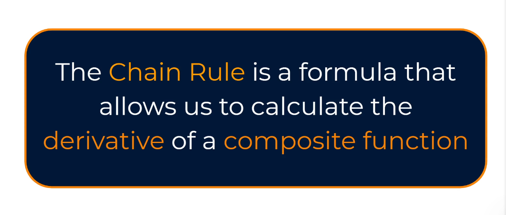

# Understanding the Chain Rule in Neural Networks

## Table of Contents

1. [Why Do We Need the Chain Rule?](#why-do-we-need-the-chain-rule)
2. [The Core Concept](#the-core-concept)
3. [Mathematical Foundation](#mathematical-foundation)
4. [Chain Rule in Neural Networks](#chain-rule-in-neural-networks)
5. [Backpropagation: Putting It All Together](#backpropagation-putting-it-all-together)
6. [Practical Example](#practical-example)
7. [Key Takeaways](#key-takeaways)

---

## Why Do We Need the Chain Rule?

In machine learning, we're trying to solve a fundamental problem: **how do we adjust the weights and biases in a neural network to minimize loss?**

Consider this two-part statement:

1. **The prediction is a function** that takes inputs and weights to produce an output
2. **The loss is a function** that measures how far our prediction is from the actual answer

Here's the critical insight: To know how to adjust a single weight value, we need to understand how changes in that weight propagate through the entire network and ultimately affect the loss. This is where the chain rule becomes essential.

**Without the chain rule**, we'd need to calculate a separate derivative for each individual weight manually—an impossible task in modern networks with millions of parameters. **With the chain rule**, we can elegantly connect the beginning (input weights) to the end (loss) through a single composite function.

---

## The Core Concept

The chain rule answers this question: _How do we find the derivative of a composite function?_

**In simple terms:** When you have functions nested inside each other (function composition), the chain rule tells you how to find the rate of change by multiplying the rates of change of each layer.

### The Chain Rule Formula

If we have: `y = f(g(x))`

Then: **dy/dx = (dy/dg) × (dg/dx)**

Or more intuitively: _"The derivative of the outside function times the derivative of the inside function"_

---

## Mathematical Foundation

### Simple Example: One Composite Function

Let's say:

- `u = x²` (inside function)
- `y = u³` (outside function)
- Therefore: `y = (x²)³ = x⁶`

Using the chain rule:

```
dy/dx = (dy/du) × (du/dx)
      = (3u²) × (2x)
      = 3(x²)² × 2x
      = 6x⁵
```

We can verify this is correct since the direct derivative of x⁶ is indeed 6x⁵.

### Why This Matters for Neural Networks

Imagine a neural network layer with:

- Input: `x`
- Weight: `w`
- Computation: `z = w × x + b` (linear transformation)
- Activation: `a = σ(z)` (like ReLU or sigmoid)
- Loss: `L = (a - y_true)²` (mean squared error)

To know how much to adjust `w`, we need:

```
dL/dw = (dL/da) × (da/dz) × (dz/dw)
```

Each term is a local derivative that we can compute easily. The chain rule combines them into the overall effect.

---

## Chain Rule in Neural Networks

### The Problem with Deep Networks

In a simple network with one hidden layer, finding derivatives is manageable. But real-world neural networks have many layers:

```
Input → Layer 1 → Layer 2 → Layer 3 → ... → Layer N → Output → Loss
  x       w₁       w₂       w₃          wₙ      ŷ         L
```

Each layer contains:

- Multiple neurons
- Multiple weights
- Multiple biases
- An activation function

The question becomes: **How does changing w₁ affect the final loss L?**

The answer requires chaining together all the derivatives from Layer 1 all the way through to the loss. This is precisely what the chain rule enables.

### Why Gradients Matter

The derivative (or gradient in multidimensional space) tells us:

- **The slope**: How steep is the terrain at our current location?
- **The direction**: Which way should we move to decrease loss?
- **The magnitude**: How much should we adjust?

Imagine standing on a hillside in fog (the terrain is the loss function):

- If you need to get to the valley (minimize loss), which direction should you go?
- The gradient points downhill—it tells you which direction is steepest
- The magnitude tells you how steep that direction is

---

## Backpropagation: Putting It All Together

Backpropagation is the algorithm that uses the chain rule to efficiently compute gradients for all weights and biases in a network.

### The Flow

```
Forward Pass:
Input → Compute z₁ → Apply σ₁ → Compute z₂ → Apply σ₂ → ... → Loss

Backward Pass (Chain Rule in Action):
Loss ← (dL/dŷ) ← (dŷ/dz_n) ← (dz_n/dw_n) ← ... ← (dz₁/dw₁)
         ↓          ↓            ↓                    ↓
     Gradient   Gradient    Gradient             Gradient
     of loss    of output   of weight            of weight
```

At each step going backward, we multiply the incoming gradient by the local gradient—this **is the chain rule in action**.

### Key Insight

Instead of computing the effect of each weight individually (which would require millions of separate calculations), backpropagation computes all derivatives in a single backward pass by reusing intermediate computations.

---

## Practical Example

Let's trace through a small concrete example:

### Setup

```
Input: x = 2
Weight: w = 3
Bias: b = 1
Activation function: ReLU (max(0, z))
Target output: y_true = 10
Loss function: L = (a - y_true)²
```

### Forward Pass

```
z = w × x + b = 3 × 2 + 1 = 7
a = ReLU(z) = max(0, 7) = 7
L = (7 - 10)² = (-3)² = 9
```

### Backward Pass (Using Chain Rule)

Step 1: Gradient of loss with respect to output

```
dL/da = 2(a - y_true) = 2(7 - 10) = -6
```

Step 2: Gradient of output with respect to z (activation derivative)

```
Since z = 7 > 0, ReLU'(z) = 1
da/dz = 1
```

Step 3: Gradient of z with respect to weight

```
dz/dw = x = 2
```

Step 4: Apply the chain rule

```
dL/dw = (dL/da) × (da/dz) × (dz/dw)
      = (-6) × (1) × (2)
      = -12
```

### Interpretation

The gradient is -12, meaning:

- If we increase `w` by a small amount, the loss decreases
- We should adjust `w` in the positive direction
- The adjustment: `w_new = w - learning_rate × (-12)`

If learning_rate = 0.01:

```
w_new = 3 - 0.01 × (-12) = 3 + 0.12 = 3.12
```

This new weight moves us slightly toward lower loss!

---

## Key Takeaways

1. **The chain rule connects cause and effect**: It shows how changes in weights ultimately affect the loss.

2. **It's efficient**: Instead of computing millions of individual derivatives, we efficiently chain local derivatives together.

3. **It's the foundation of backpropagation**: Modern deep learning is only possible because we can compute gradients quickly using the chain rule.

4. **Gradient = Direction + Magnitude**: The gradient tells us both which way to move (the direction) and how much to move (the magnitude).

5. **It scales to any network depth**: Whether your network has 2 layers or 200 layers, the chain rule works the same way, multiplying local derivatives through each layer.

6. **In practice**: You rarely compute chain rules manually—frameworks like TensorFlow and PyTorch compute them automatically through automatic differentiation. But understanding the chain rule helps you understand **why** deep learning works.

---

## Visual Summary

```
┌─────────────────────────────────────────────────────────────┐
│          How the Chain Rule Works in Neural Networks        │
├─────────────────────────────────────────────────────────────┤
│                                                              │
│  dL/dw = dL/da × da/dz × dz/dw                             │
│          └─────┘   └─────┘   └─────┘                       │
│           Loss    Activation  Input                         │
│         derivative derivative derivative                    │
│                                                              │
│  Multiply these three together to get the effect of w on L │
│                                                              │
└─────────────────────────────────────────────────────────────┘
```


