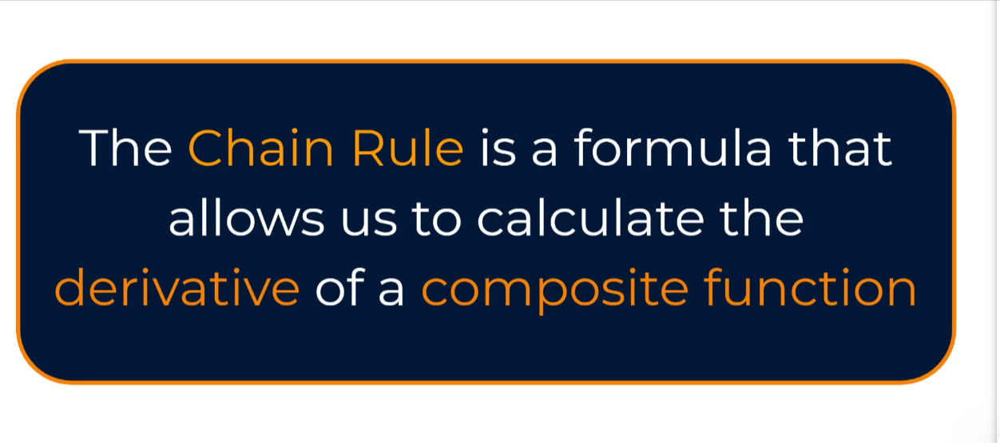
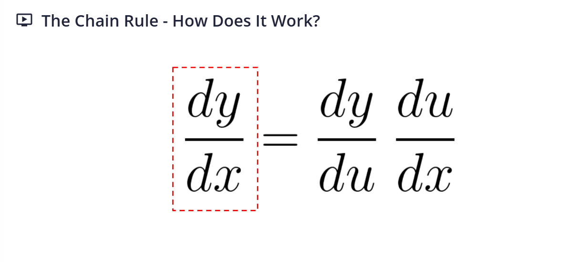
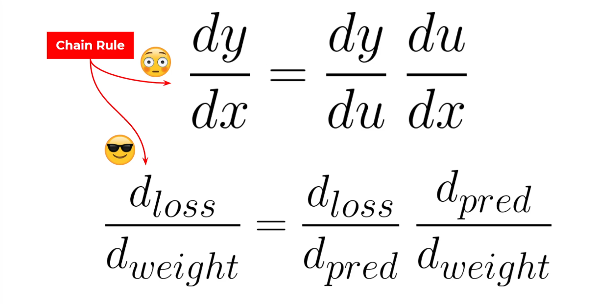
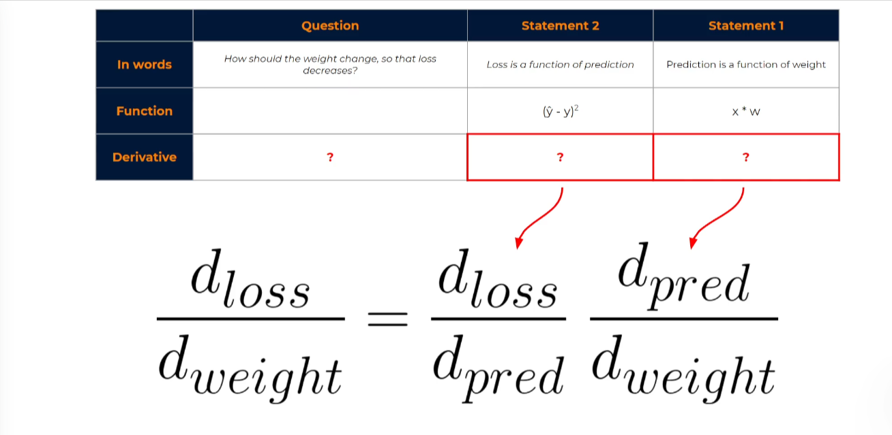

# The Chain Rule



The **chain rule** lets us calculate the derivative of a composite function:
a function formed by applying one function to the output of another. It
builds on the idea of a [derivative](../Day-146/Derivatives.md) as a rate
of change.

## Why Do Neural Networks Need It?

During a forward pass, input features travel through a network. Weights,
biases, and activation functions influence the values passed from one layer
to the next. The output is a prediction, such as a numerical value for
regression or class probabilities for classification. A loss function
compares the prediction with the actual value.

Training aims to reduce that loss by adjusting the weights and biases.
Backpropagation uses the chain rule to calculate how the loss changes with
each parameter; gradient descent then uses those derivatives to update the
parameters. This connects the effects of individual computations rather than
testing every possible parameter value.

The network and loss together form a composite function: changing a weight
can change intermediate values, which can change the prediction and,
ultimately, the loss.

## Reading the Formula



Suppose `u` is a function of `x`, and `y` is a function of `u`. The chain
rule states:

```text
dy/dx = (dy/du) * (du/dx)
```

- `dy/dx` is the rate of change of `y` with respect to `x`.
- `dy/du` is the rate of change of `y` with respect to `u`.
- `du/dx` is the rate of change of `u` with respect to `x`.

Multiplying the two local derivatives tells us how a change in `x` affects
`y` through the intermediate value `u`.

## Applying It to a Weight and Loss



In a simple network, we can replace the abstract variables with quantities
that have a concrete meaning:

```text
d(loss)/d(weight) = d(loss)/d(prediction) * d(prediction)/d(weight)
```

- `d(loss)/d(prediction)` describes how the loss changes as the prediction
  changes.
- `d(prediction)/d(weight)` describes how the prediction changes as the
  weight changes.
- `d(loss)/d(weight)` combines these effects to tell us how the loss changes
  as the weight changes.

This two-factor form assumes the weight affects the loss through the
prediction. More complex networks may have additional intermediate
computations or multiple paths whose contributions must be combined.

## Setting Up the Example



For the simple example in the image, let `x` be a fixed input, `w` the
weight, `y` the fixed actual value, and `y_hat` the prediction:

```text
prediction: y_hat = x * w
loss:       L = (y_hat - y)^2
```

The question is: **How should `w` change to reduce the loss?** We can answer
it by finding the derivative of each function and multiplying them:

```text
dL/dw = (dL/dy_hat) * (dy_hat/dw)
```

The sign of `dL/dw` indicates the local direction of increasing loss, so
gradient descent moves the weight in the opposite direction. Its magnitude,
together with the learning rate, determines the size of the update. A
sufficiently large update can overshoot, so a lower loss is not guaranteed
for every step.

The next tutorial works through the derivatives and the weight update.
