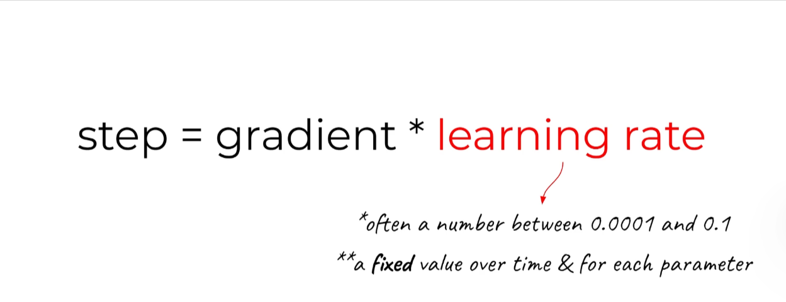
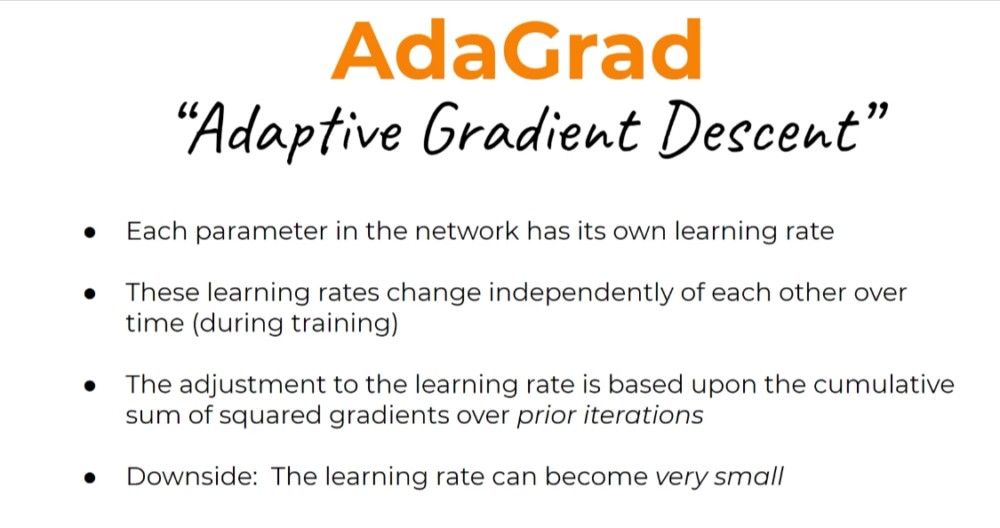

# Global and Local Minima: A Beginner-Friendly Guide

When a neural network trains, the goal is to make the **loss as small as possible**.

Imagine walking across a hilly landscape in fog. The height represents the loss:

- A **high position** means a high loss, so the model is making many errors.
- A **low position** means a low loss, so the model is making fewer errors.
- A **valley** is a minimum.

Gradient descent tries to walk toward a lower position.

---

## 1. What is a local minimum?

A **local minimum** is a point where the loss is lower than all nearby points.

It is like standing in a small valley: every step in the immediate area goes uphill, but a much lower valley may exist somewhere else.

```text
Loss
  |
  | \    /
  |  \  /   \
  |   \/     \  __
  |   Local  \_/  Global minimum
  |   minimum
  +---------------------- Parameters
```

A model trapped in a local minimum may have:

- low training loss
- poor validation performance
- no nearby gradient direction that appears useful

---

## 2. What is a global minimum?

A **global minimum** is the lowest possible loss across the entire parameter space.

In the simplest and best case:

```text
global minimum = the lowest possible loss
```

Finding the exact global minimum is often difficult for neural networks because they have many parameters and a very complicated loss surface.

---

## 3. Local minimum vs. global minimum

| Local minimum                           | Global minimum                          |
| --------------------------------------- | --------------------------------------- |
| Lowest loss in a nearby region          | Lowest loss across the entire landscape |
| There may be better valleys elsewhere   | No better point exists                  |
| Easy to confuse with the final solution | Ideal solution                          |
| Common in complex models                | Difficult to guarantee                  |

A useful local minimum can still produce a good model. Training does not always require reaching the exact global minimum.

---

## 4. Saddle points

A **saddle point** is another type of point that can slow training.

At a saddle point:

- it is a minimum in some directions
- it is a maximum in other directions
- the gradient may be close to zero

This can make optimization appear stuck even though the model can continue improving by moving in another direction.

---

## 5. Why local minima are less troubling than beginners expect

In modern neural networks:

- the loss surface is very high-dimensional
- many points can be considered useful solutions
- two different parameter combinations may have similar loss
- good local minima often produce strong validation performance

Therefore, the practical goal is usually **a sufficiently low loss**, not proof that the exact global minimum was reached.

---

## 6. How optimizers help

Optimizers control how the model moves through the loss landscape.

The update shown below illustrates the basic role of the learning rate:



An optimizer uses the gradient to choose the direction and step size:

```text
new parameter = old parameter - learning rate × gradient
```

Adaptive optimizers, such as Adam or AdaGrad, can change learning behavior for each parameter:



Helpful optimization techniques include:

- choosing a suitable learning rate
- using momentum
- using mini-batches
- trying Adam or RMSprop
- using random weight initialization
- applying learning-rate schedules
- using regularization

---

## 7. How momentum helps

**Momentum** remembers previous updates.

Imagine pushing a ball downhill:

- it is pulled toward lower loss
- previous movement helps it continue
- it can roll past a small local minimum or narrow barrier

Momentum does not guarantee that the model will find the global minimum, but it can reduce zigzag movements and help training progress.

---

## 8. The role of initialization

Random initialization starts a model at a random position in the loss landscape.

Different starting points can lead to:

- different local minima
- different saddle-point paths
- different final performance

That is why the same model architecture can produce different results when trained with different random seeds.

For more reliable comparisons:

```text
set a random seed
train with the same data
train with the same parameters
compare the results
```

---

## 9. What to do when training appears stuck

If loss stops decreasing:

1. Check whether the learning rate is too large or too small.
2. Compare training and validation loss.
3. Inspect gradients for exploding or vanishing values.
4. Try an adaptive optimizer.
5. Use momentum or a learning-rate schedule.
6. Restart training with a new random initialization.
7. Verify the data, labels, preprocessing, and loss function.

A plateau is not always a local minimum. It could be a saddle point, a learning-rate problem, or a normalization problem.

---

## 10. Mini example

Suppose we compare three training runs:

| Run | Final training loss | Validation accuracy |
| --- | ------------------: | ------------------: |
| 1   |                0.45 |                 82% |
| 2   |                0.31 |                 91% |
| 3   |                0.29 |                 90% |

- Run 1 may have stopped at a less useful solution.
- Run 2 and Run 3 reached useful low-loss regions.
- Run 3 has slightly lower training loss but not better validation accuracy.

This shows that **the lowest training loss is not always the best model**.

The validation result matters.

---

## Final takeaway

A local minimum is the lowest loss in a nearby region. A global minimum is the lowest loss across the entire problem.

Neural network training may find useful local minima rather than the exact global minimum. That is acceptable if the model generalizes well.

For a beginner, remember:

```text
Backpropagation calculates the gradient.
The optimizer changes the parameters.
The goal is useful generalization, not just reaching one theoretical minimum.
```
