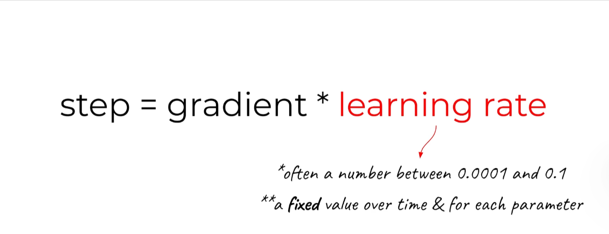
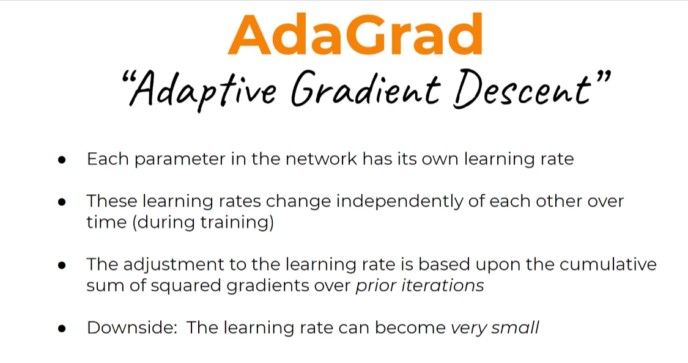

# Optimizers: A Beginner-Friendly Guide

After backpropagation calculates the gradients, an **optimizer** decides how to change the model's parameters so that the loss becomes smaller.

There are two parts to training:

1. **Backpropagation** calculates how each parameter affects the loss.
2. **The optimizer** uses those gradients to update the parameters.

The basic gradient descent update is:

```text
new parameter = old parameter - learning rate × gradient
```

For example, if a weight has gradient `0.25` and the learning rate is `0.01`:

```text
new weight = old weight - (0.01 × 0.25)
```

---

## 1. What is a learning rate?

The **learning rate** controls the size of each update. The next image shows the update visually:



- A **small learning rate** makes slow, careful updates.
- A **large learning rate** makes large updates that may overshoot the minimum.
- A learning rate that is too small can take too many steps to train.
- A learning rate that is too large can make the loss become unstable or increase.

Learning rates are usually values such as `0.1`, `0.01`, `0.001`, or `0.0001`, depending on the model and optimizer.

---

## 2. The simplest optimizer: gradient descent

In **gradient descent**, all parameters receive an update based on their gradients.

```text
θ = θ - α × dL/dθ
```

Where:

- `θ` is a parameter, such as a weight or bias
- `α` is the learning rate
- `dL/dθ` is the gradient calculated by backpropagation

The minus sign is important: gradients point toward increasing loss, so we move in the opposite direction to reduce it.

### Types of gradient descent

| Type | Uses | Advantage | Disadvantage |
|---|---|---|---|
| Batch gradient descent | All training data for every update | Stable gradients | Slow for large datasets |
| Stochastic gradient descent (SGD) | One sample at a time | Fast and simple | Noisy updates |
| Mini-batch gradient descent | A small group of samples | Good balance of speed and stability | Requires choosing a batch size |

Modern neural networks usually use **mini-batch gradient descent**.

---

## 3. SGD with momentum

Basic SGD can move in a zigzag pattern when gradients change direction.

**Momentum** remembers the previous update and adds part of it to the next update:

```text
velocity = beta × velocity + gradient
parameter = parameter - learning rate × velocity
```

Momentum is like a ball rolling downhill: it can continue moving in a useful direction instead of changing direction too abruptly.

A common momentum value is `0.9`.

---

## 4. AdaGrad

**AdaGrad** gives each parameter its own learning rate.

- Parameters that receive large or frequent gradients get smaller future updates.
- Parameters that receive small gradients get larger future updates.

This helps the optimizer adapt to parameters that behave differently.

```text
AdaGrad = Adaptive Gradient
```



AdaGrad keeps a running sum of squared gradients:

```text
accumulator = accumulator + gradient²
adjusted learning rate = learning rate / sqrt(accumulator + epsilon)
parameter = parameter - adjusted learning rate × gradient
```

### Simple intuition

If a weight's gradient has been large many times, AdaGrad reduces its effective learning rate.

If another weight's gradient has remained small, AdaGrad allows it to keep learning.

### Main drawback

AdaGrad's accumulated gradient keeps growing. In long training runs, the effective learning rate can become too small and training may stop making progress.

---

## 5. RMSprop

**RMSprop** fixes AdaGrad's main drawback by keeping only an average of recent squared gradients instead of the sum of every gradient.

```text
moving average = beta × moving average + (1 - beta) × gradient²
adjusted learning rate = learning rate / sqrt(moving_average + epsilon)
parameter = parameter - adjusted learning rate × gradient
```

Here:

- `beta` controls how quickly old gradients are forgotten
- `epsilon` prevents division by zero
- The effective learning rate adapts for each parameter

RMSprop is useful when gradients change significantly during training.

---

## 6. Adam

**Adam** combines the ideas of:

- **Momentum**, which uses a moving average of gradients
- **RMSprop**, which uses a moving average of squared gradients

The name means **Adaptive Moment Estimation**.

In simple form:

```text
first moment  = moving average of gradients
second moment = moving average of squared gradients
parameter     = parameter - learning rate × first_moment / sqrt(second_moment)
```

Adam is one of the most commonly used optimizers because it usually works well with little tuning.

Typical starting values are:

```text
learning rate = 0.001
beta1         = 0.9
beta2         = 0.999
epsilon       = 10^-8
```

Adam can still diverge or overfit, so it is not automatically the best choice for every problem.

---

## 7. Quick comparison

| Optimizer | Adaptive learning rate | Uses momentum | Simple use case |
|---|---:|---:|---|
| SGD | No | No | Small or simple problems |
| SGD with Momentum | No | Yes | Faster, smoother SGD updates |
| AdaGrad | Yes | No | Sparse gradients; may become too slow |
| RMSprop | Yes | No | Changing gradients and recurrent networks |
| Adam | Yes | Yes | Strong general-purpose default |

---

## 8. Choosing a beginner-friendly optimizer

For a first deep learning project:

1. Start with **Adam** and a learning rate of `0.001`.
2. If Adam does not perform well, try **SGD with momentum**.
3. Monitor validation loss, not only training loss.
4. Try one change at a time.
5. Use a lower learning rate if the loss oscillates or becomes unstable.

For this MNIST-style setup, Adam is often a good starting point:

```python
optimizer = Adam(learning_rate=0.001)
model.compile(
    optimizer=optimizer,
    loss="categorical_crossentropy",
    metrics=["accuracy"]
)
```

The exact API depends on your framework. TensorFlow/Keras and PyTorch both provide Adam implementations.

---

## 9. What is still most important?

An optimizer changes parameters, but it cannot fix every problem.

Training may fail because of:

- a poorly chosen learning rate
- an unsuitable loss function
- bad or insufficient data
- overfitting
- exploding or vanishing gradients
- an incorrect data preprocessing step

As a beginner, focus on these observations:

- Loss decreases steadily: training is progressing.
- Loss oscillates: the learning rate may be too high.
- Loss decreases very slowly: the learning rate may be too low or the optimizer may need adjustment.
- Training loss improves but validation loss worsens: the model may be overfitting.

---

## Final takeaway

Backpropagation tells the optimizer:

> “How much should each parameter change?”

The optimizer tells the model:

> “Use these gradients and this learning rule to make the next update.”

The learning rate controls update size. SGD is the basic method. Momentum adds memory. AdaGrad and RMSprop adapt learning rates for each parameter. Adam combines adaptive learning rates with momentum and is a strong beginner starting point.
